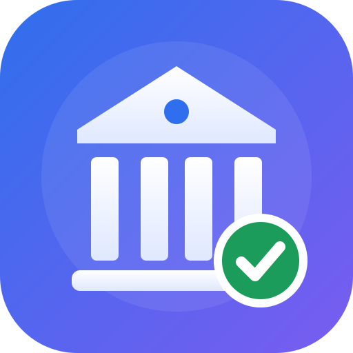

  

# مدیریت کلاس

برنامهٔ وب فارسی (RTL) برای مدیریت مدرسه: کلاس‌ها، دانش‌آموزان، برنامهٔ هفتگی، حضور و غیاب، نمرات، کارنامه و پیامک اولیا
با **ادمین اصلی** و **مدیر مدرسه** و دسترسی قابل تنظیم برای هر مدرسه

## نقش‌ها

| نقش | کارها |
|---|---|
| ادمین اصلی | ساخت مدرسه، تعیین نام کاربری/رمز و لینک ورود مدیر، تعیین بخش‌های قابل دیدن، فعال/غیرفعال و حذف مدرسه، ورود به هر مدرسه با دسترسی کامل |
| مدیر مدرسه | ورود با لینک اختصاصی و کار در بخش‌هایی که ادمین فعال کرده |

## راه‌اندازی

1. فایل `index.html` را روی GitHub Pages یا Netlify منتشر کنید (فایل `.nojekyll` همراه است).
2. دیتابیس Supabase باید جدول‌ها و توابع `cm_*` را داشته باشد (فایل `supabase/cm_roles.sql`).
3. اولین بار صفحه را باز کنید و **بلافاصله** ادمین اصلی را بسازید؛ تا آن لحظه فرم ساخت ادمین برای همه باز است.
4. در پنل ادمین مدرسه بسازید و پیام ورود (نام کاربری، رمز، لینک) را برای مدیر بفرستید.

## نکات امنیتی

- کلید داخل فایل از نوع `publishable` است و برای قرار گرفتن در مخزن عمومی مناسب است؛ دسترسی واقعی با RLS و توابع سمت سرور کنترل می‌شود.
- محدودیت تب‌ها در رابط کاربری اعمال می‌شود؛ مدیر مدرسه از سمت سرور فقط به اطلاعات مدرسهٔ خودش دسترسی دارد.
- رمزها با bcrypt ذخیره می‌شوند و ورود ناموفق پس از ۸ تلاش به‌مدت ۱۵ دقیقه قفل می‌شود.
